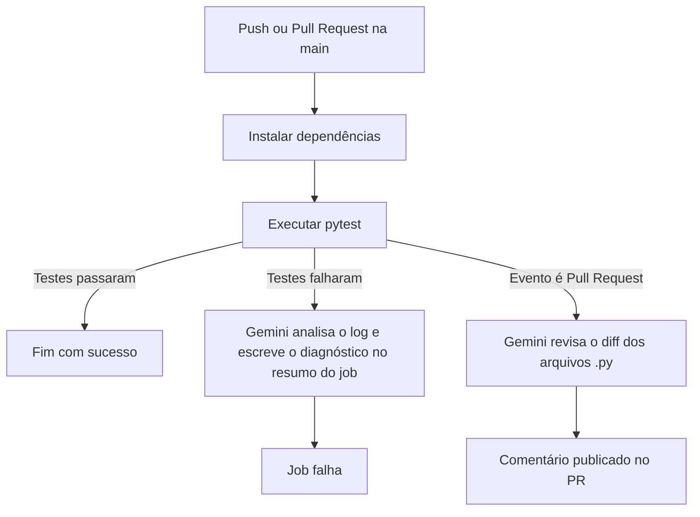

# lab-ci-ia

Laboratório de integração contínua com diagnóstico por IA. O projeto reúne uma calculadora em Python, uma suíte de testes com pytest e um pipeline no GitHub Actions que usa a API do Gemini para explicar falhas de testes e revisar Pull Requests.

## Sumário

- [Estrutura do projeto](#estrutura-do-projeto)
- [Requisitos](#requisitos)
- [Instalação](#instalação)
- [Uso da calculadora](#uso-da-calculadora)
- [Testes](#testes)
- [Pipeline de CI](#pipeline-de-ci)
- [Convenções de código](#convenções-de-código)
- [Licença](#licença)

## Estrutura do projeto

```text
.
├── .github/workflows/ci.yml   # Pipeline de CI com diagnóstico por IA
├── calculadora.py             # Módulo com as operações matemáticas
├── conftest.py                # Torna a raiz do projeto importável nos testes
├── requirements.txt           # Dependências de desenvolvimento
├── tests/
│   └── test_calculadora.py    # Testes unitários
├── LICENSE
└── README.md
```

## Requisitos

- Python 3.12 ou superior (versão usada no CI)
- pip

## Instalação

```bash
git clone <url-do-repositorio>
cd lab-ci-ia

python3 -m venv .venv
source .venv/bin/activate

pip install -r requirements.txt
```

## Uso da calculadora

O módulo [calculadora.py](calculadora.py) expõe seis funções:

| Função | Descrição | Erros |
| --- | --- | --- |
| `somar(a, b)` | Soma de `a` e `b` | |
| `subtrair(a, b)` | Diferença `a - b` | |
| `multiplicar(a, b)` | Produto de `a` e `b` | |
| `dividir(a, b)` | Quociente `a / b` | `ValueError` se `b` for zero |
| `raiz_quadrada(n)` | Raiz quadrada de `n` | `ValueError` se `n` for negativo |
| `porcentagem(valor, percentual)` | `valor * percentual / 100` | |

```python
from calculadora import dividir, porcentagem, raiz_quadrada, somar

somar(2, 3)               # 5
dividir(7, 2)             # 3.5
raiz_quadrada(9)          # 3.0
porcentagem(200, 10)      # 20.0

dividir(1, 0)             # ValueError: Divisão por zero não é permitida
```

### Comportamento com entradas inesperadas

As funções não validam tipos. Isso significa que:

- `None` e `str` na maioria das operações geram o `TypeError` nativo do Python.
- `multiplicar("ab", 2)` não gera erro e retorna `"abab"`, porque o Python repete a string.
- `nan` e `inf` seguem a aritmética de ponto flutuante do IEEE 754 e não são rejeitados.
- `porcentagem` aceita percentuais negativos e maiores que 100.

Cada função tem docstring no estilo Google, com `Args`, `Returns`, `Raises` e `Example`. Para consultar a ajuda no terminal:

```bash
python3 -c "import calculadora; help(calculadora.dividir)"
```

## Testes

Os testes ficam em [tests/test_calculadora.py](tests/test_calculadora.py), organizados em uma classe por função. Eles cobrem:

- **Casos felizes:** inteiros, floats, negativos e zero.
- **Casos de borda:** precisão de ponto flutuante, overflow para `inf`, inteiros muito grandes, `nan`, `-0.0` e percentuais fora do intervalo usual.
- **Cenários de erro:** `ValueError` com verificação da mensagem e `TypeError` para entradas inválidas.

Executar a suíte:

```bash
pytest
```

Executar com cobertura e doctests (exemplos das docstrings):

```bash
pytest --cov=calculadora --cov-report=term-missing --doctest-modules calculadora.py tests
```

A cobertura atual de `calculadora.py` é de 100%.

## Pipeline de CI

O workflow [.github/workflows/ci.yml](.github/workflows/ci.yml) roda em `push` e em `pull_request` para a branch `main`.



Etapas principais:

1. **Executar testes:** roda `pytest --tb=short` e grava a saída em `test-results.log`. A etapa não interrompe o job, para que a análise possa rodar.
2. **Analisar falha com IA:** se os testes falharem, envia as últimas 100 linhas do log ao Gemini e publica um diagnóstico de 3 pontos no resumo do job.
3. **Analisar PR com IA:** em Pull Requests, envia o diff dos arquivos `.py` ao Gemini e comenta no PR até 5 sugestões de melhoria.
4. **Falhar o job:** se os testes falharam, o job termina com erro após a análise.

### Configuração necessária

Cadastre o segredo `GEMINI_API_KEY` em **Settings > Secrets and variables > Actions** do repositório. Sem ele, as etapas de IA não retornam conteúdo.

Os testes não dependem desse segredo e rodam normalmente sem ele.

## Convenções de código

- Docstrings no estilo Google, seguindo a PEP 257.
- Type hints em todas as funções, seguindo a PEP 484.
- Mensagens de erro e documentação em português.
- Novas funções devem vir acompanhadas de testes com casos felizes, de borda e de erro.

## Licença

Distribuído sob a licença GNU GPL v3. Veja o arquivo [LICENSE](LICENSE).
